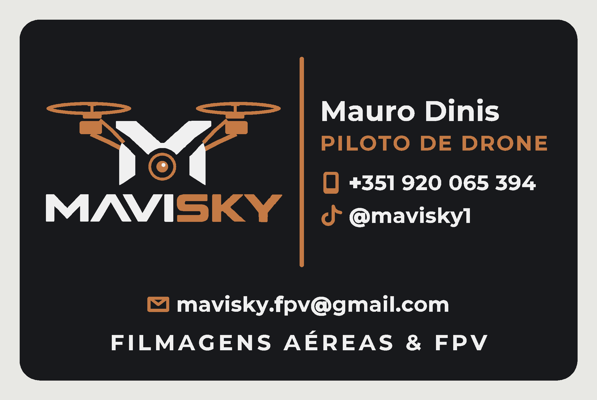
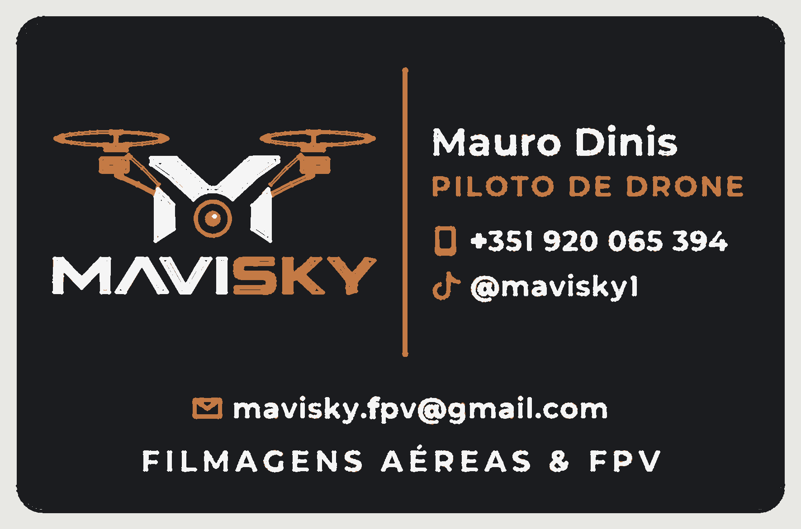

# Cartão de visita MAVISKY — impressão 3D em 3 cores (QIDI Plus 4 + QIDI Box)

Cartão 85 × 55 mm em PLA, a três cores (preto, cobre e branco), pensado para
gastar o **mínimo de filamento** na QIDI Plus 4 com a QIDI Box.



## Porque gasta tão pouco

Num cartão multicor normal, cada camada tem várias cores. Isso obriga a trocar de
filamento em todas as camadas e a purgar sempre, e é a purga que mais gasta.
Este cartão foi desenhado em **degraus, com uma só cor por camada**:

| camadas (0,2 mm) | altura | cor | slot da Box |
|---|---|---|---|
| 1–3 | 0,0–0,6 mm | preto (base, cartão inteiro) | 1 |
| 4–5 | 0,6–1,0 mm | cobre (elementos cobre + base dos brancos) | 2 |
| 6–7 | 1,0–1,4 mm | branco (letras e M brancos) | 3 |

Resultado:

- **Só 2 trocas de filamento** por impressão, seja 1 cartão ou 12.
- **Sem torre de purga.** A purga vai para o caixote da Plus 4, como no QIDI Studio.
- **Purgas reduzidas.** A 1.ª camada de cada cor nova fica tapada pela seguinte,
  por isso um resto da cor anterior não se vê (preto→cobre 180 mm³, cobre→branco 260 mm³).
- Os brancos assentam sobre cobre, que tapa melhor do que o preto. As letras
  brancas ficam com um rebordo cobre nos lados, o que dá um efeito de relevo.

| G-code | preto | cobre | branco | **total** | tempo* |
|---|---|---|---|---|---|
| 1 cartão | 3,46 g | 0,62 g | 0,64 g | **4,7 g** | ~11 min |
| 12 cartões (3×4) | 41,1 g | 2,9 g | 2,1 g | **46,1 g = 3,8 g/cartão** | ~2 h 13 |

\* estimativa do fatiador, sem contar as 2 trocas (~2–3 min cada).
**A placa de 12 é a mais económica**: as 2 purgas são divididas por 12 cartões.

## Ficheiros

| pasta / ficheiro | para quê |
|---|---|
| `gcode/cartao-mavisky-1x-qidi-plus4-box.gcode` | **pronto a imprimir**: 1 cartão |
| `gcode/cartao-mavisky-12x-qidi-plus4-box.gcode` | **pronto a imprimir**: 12 cartões |
| `qidi-studio/cartao-mavisky-1x-QIDIStudio.3mf` | projeto QIDI Studio (peças já com a cor certa) |
| `qidi-studio/cartao-mavisky-12x-QIDIStudio.3mf` | idem, placa de 12 |
| `fusion360/cartao-mavisky-3cores.step` | **Fusion 360**: 3 corpos sólidos coloridos |
| `fusion360/cartao-mavisky-camadas.dxf` | **Fusion 360**: contornos 2D editáveis, 1 layer por cor |
| `stl/cartao-mavisky-{1-base-preto,2-cobre,3-branco}.stl` | malhas por cor (para qualquer fatiador) |
| `dados.json` | nome, função e contactos (Mauro Dinis, telefone, email, TikTok) |
| `previews/` | vista de cima e simulação do G-code |
| `slicer/` | configuração usada, perfis oficiais QIDI, projetos PrusaSlicer |
| `scripts/` | gerador completo (geometria → STEP/STL/DXF → G-code → projeto QIDI) |

## Imprimir

1. **Carregar a Box**: slot 1 = PLA **preto**, slot 2 = PLA **cobre/laranja**,
   slot 3 = PLA **branco**. O G-code usa T0/T1/T2, que correspondem aos slots 1/2/3.
2. **Placa**: PEI texturada (ou lisa, para um verso liso), cama a 60 °C, bico a 210 °C.
3. Escolher um dos caminhos:
   - **G-code**: enviar o `.gcode` pelo Fluidd, pela app QIDI ou por pen USB, e imprimir.
   - **QIDI Studio**: abrir o `.3mf` → confirmar a impressora "X-Plus 4 0.4 nozzle" e as
     3 cores → *Fatiar* → *Imprimir*. Na janela de envio, mapear as cores para os slots.
4. No fim, o cartão sai da placa dobrando-a ligeiramente.

Se o projeto `.3mf` não abrir com as cores atribuídas, por exemplo numa versão muito
diferente do QIDI Studio, faz-se em 1 minuto:
*Importar* os 3 STL de `stl/` de uma vez → responder **Sim** a "carregar como um objeto
com várias partes" → atribuir filamento 1/2/3 a base/cobre/branco → em *Outros*,
desligar a *torre de purga*.

### Notas sobre o G-code

- Foi fatiado com o PrusaSlicer 2.7, com valores dos perfis oficiais do QIDI Studio
  ("X-Plus 4 0.4 nozzle", "0.20mm Standard @XPlus4", "QIDI PLA Basic"): velocidades,
  acelerações, temperaturas, retração, G-code de início e de fim.
- **Cada troca de filamento é o G-code oficial da QIDI para a Box**
  (`TOOL_CHANGE_START`, `CUT_FILAMENT`, `MOVE_TO_TRASH`, `UNLOAD_T`, purga,
  `CLEAR_FLUSH`, `CLEAR_OOZE`, `TOOL_CHANGE_END`), com os valores que o QIDI Studio
  calcula para cada troca.
- Foi verificado automaticamente: só 3 comandos de ferramenta (T0, T1, T2), uma cor por
  camada e área impressa dentro da cama, longe das zonas excluídas.
- Como não foi gerado pelo próprio QIDI Studio, **na primeira impressão convém ver a
  1.ª troca de filamento** (a meio da camada 4).

## Editar no Fusion 360

- **STEP** (`Inserir → Inserir no projeto atual`, ou abrir): entra como 3 corpos
  (base preta, cobre, branco) já na altura certa. Serve para ver, medir, fazer
  renders, ou juntar a outros modelos.
- **DXF** (`Inserir → Inserir DXF`): contornos de cada cor em layers separadas
  (`1_BASE_PRETO`, `2_COBRE`, `3_BRANCO`). Para alterar o desenho:
  extrudir a base 0,6 mm, os contornos cobre de 0,6 a 1,0 mm e os brancos de 1,0 a 1,4 mm.
- Para mudar só o texto (nome, telefone…) é mais rápido usar o gerador (abaixo),
  que já aplica as regras de legibilidade.

## Mudar nome e contactos

Editar `dados.json` e correr na pasta `cartao-3d`:

```
python3 scripts/gerar_tudo.py
```

O script regenera tudo: STEP, DXF, STL, os 2 G-codes, os 2 projetos QIDI Studio e as
pré-visualizações. Contactos disponíveis: `telefone`, `email`, `site`, `instagram`, `tiktok`;
só aparecem os que estiverem preenchidos. Um contacto comprido demais para a coluna
(como o email) passa automaticamente para uma faixa na largura toda, por cima da tagline,
em vez de encolher. Se mesmo assim não couber, o script avisa.

## Regras de desenho para o bico de 0,4 mm

- Texto em **Montserrat Bold com maiúsculas ≥ 2,2 mm**: traços de ~0,49 mm e espaços
  de ~0,44 mm (medido na fonte), por isso as letras não se fecham.
- "@" em Montserrat Black; "t", "+" e "f" ligeiramente engrossados (têm braços curtos
  que o fatiador perdia).
- Os glifos são preenchidos pela regra *nonzero* (número de enrolamento), como num
  renderizador de fontes: a Montserrat variável tem contornos sobrepostos e que se
  cruzam ("4", "A", "P", "R").
- Arachne com tamanho mínimo de pormenor 10% e largura mínima de linha 60%: valores
  escolhidos por medição, por terem a melhor cobertura do texto pequeno
  (92% de cobertura, 2% de excesso).
- O M e "MAVISKY" vêm traçados do logótipo original. As partes do drone foram
  redesenhadas em vetor limpo, com traços ≥ 0,5 mm, porque no logótipo são um render
  fotorrealista.



*Simulação feita a partir do G-code real (trajetórias com a largura de linha real).*

Fonte Montserrat: SIL Open Font License (`fontes/OFL.txt`). Perfis em
`slicer/perfis-qidi-oficiais/`: copiados do repositório público do QIDI Studio.
