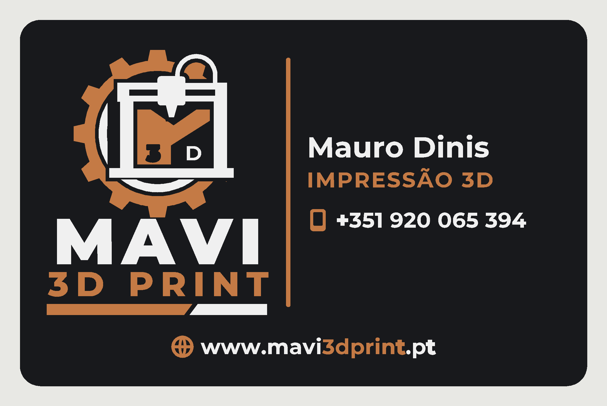

# Cartão MAVI 3D PRINT — impressão 3D em 3 cores (QIDI Plus 4 + QIDI Box)

Mesmo método do cartão MAVISKY (ver `../README.md`): 85 × 55 mm, **uma só cor por
camada** (base preta → cobre → branco), **2 trocas de filamento**, sem torre de purga.



O logótipo foi **redesenhado em vetor** a partir do banner da marca, com engrenagem de
12 dentes, impressora, M com "3" e "D", "MAVI", "3D PRINT" e as barras
(`../scripts/logo_mavi3d.py`). O "3" escuro tem um recorte largo para se ver na impressão.

| G-code | preto | cobre | branco | **total** | tempo* |
|---|---|---|---|---|---|
| 1 cartão | 3,46 g | 0,73 g | 0,68 g | **4,9 g** | ~11 min |
| 12 cartões (3×4) | 41,1 g | 4,3 g | 2,6 g | **48,0 g = 4,0 g/cartão** | ~2 h 07 |

\* sem as 2 trocas da Box (~2–3 min cada).

## Ficheiros

| ficheiro | para quê |
|---|---|
| `gcode/cartao-mavi3dprint-1x-qidi-plus4-box.gcode` | pronto a imprimir: 1 cartão |
| `gcode/cartao-mavi3dprint-12x-qidi-plus4-box.gcode` | pronto a imprimir: 12 cartões |
| `qidi-studio/cartao-mavi3dprint-{1x,12x}-QIDIStudio.3mf` | projetos QIDI Studio |
| `fusion360/cartao-mavi3dprint-3cores.step` | Fusion 360: 3 corpos coloridos |
| `fusion360/cartao-mavi3dprint-camadas.dxf` | Fusion 360: contornos por cor |
| `stl/` | malhas por cor |
| `dados.json` | nome, função, contactos |

Box: **slot 1 preto, slot 2 cobre, slot 3 branco** (PLA). Cama a 60 °C, bico a 210 °C.

## Alterar

Editar `dados.json` e correr, na pasta `cartao-3d`:

```
python3 scripts/gerar_tudo.py mavi3dprint
```

Texto entre `[ ]` sai a cobre, como em `www.mavi[3dprint].pt`. Contactos disponíveis:
`telefone`, `email`, `site`, `instagram`, `tiktok`; só aparecem os preenchidos.
