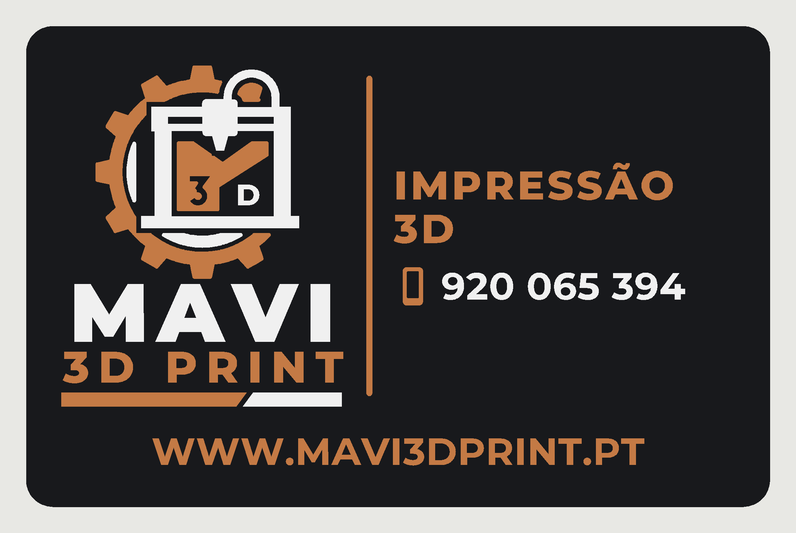
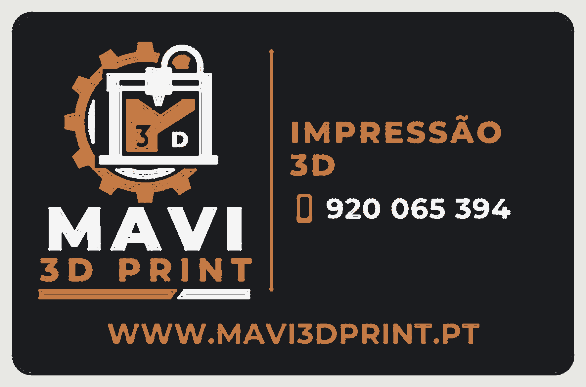

# Cartão MAVI 3D PRINT — impressão 3D em 3 cores (QIDI Plus 4 + QIDI Box)

Mesmo método do cartão MAVISKY (ver `../README.md`): 85 × 55 mm, **uma só cor por
camada** (base preta → cobre → branco), **2 trocas de filamento**, sem torre de purga.



Mesma receita do MAVISKY final (3 impressões de teste): base preta 0–0,6 mm, cobre
0,6–1,2 mm (3 camadas), branco 1,2–1,8 mm (3 camadas); bico 205 °C (1.ª camada 210),
retração 1,0 mm a 40 mm/s, Arachne 10% / 60%, contactos com maiúsculas de 3,0 mm.

Conteúdo (`dados.json`): sem nome; função "IMPRESSÃO / 3D" em 2 linhas, cobre ExtraBold
3,2 mm; telefone 920 065 394; site WWW.MAVI3DPRINT.PT a cobre, na largura toda, sem ícone.

## Logótipo otimizado para impressão 3D

Redesenhado em vetor a partir do banner (`../scripts/logo_mavi3d.py`, `desenhar(p3d=True)`),
com as regras do bico 0,4 mm verificadas à escala do cartão (traço ≥ 0,45 mm, vão ≥ 0,4 mm):

- **"3"** desenhado em traço de 0,6 mm com aberturas largas (o da fonte, a 3 mm, perdia os
  dentes cobre e ficava uma mancha) e ≥ 0,5 mm de cobre por baixo.
- **"D"** em ExtraBold maior; **tubo de filamento** 1,05 mm; **anel prateado** 1,5 mm e afastado
  0,65 mm da impressora; **barras do pórtico** 1,3 mm; **bico** com ponta de 1,1 mm;
  cabeça lisa (os frisos não se imprimiam).
- "MAVI", "3D PRINT" e barras descem 2 px: o dente de baixo da **engrenagem** ficava a 0,2 mm do
  "MAVI" e fundia-se. Lascas e pontas finas (dentes cortados, extremos do anel) são removidas.
- Resultado no logótipo: traços finos de 2,8 → 0,2 mm² e vãos estreitos de 3,3 → 0,15 mm²
  (só cantos vivos das letras). O SVG/PDF do cartão em papel mantém o desenho original.

## Ficheiros

| ficheiro | para quê |
|---|---|
| `gcode/cartao-mavi3dprint-1x-qidi-plus4-box.gcode` | pronto a imprimir: 1 cartão |
| `gcode/cartao-mavi3dprint-12x-qidi-plus4-box.gcode` | pronto a imprimir: 12 cartões |
| `qidi-studio/cartao-mavi3dprint-{1x,12x}-QIDIStudio.3mf` | projetos QIDI Studio |
| `fusion360/cartao-mavi3dprint-3cores.step` | Fusion 360: 3 corpos coloridos |
| `fusion360/cartao-mavi3dprint-camadas.dxf` | Fusion 360: contornos por cor |
| `stl/` | malhas por cor |
| `dados.json` | nome, função, contactos |

Box: **slot 1 preto, slot 2 cobre, slot 3 branco** (PLA). Cama a 60 °C.

## Imprimir no QIDI Studio / QIDI Maker

Ficheiro → Abrir projeto (`.3mf`) → *Sync info* → **Use Modified Value** → Fatiar → Imprimir
(mapear 1 preto, 2 cobre, 3 branco). A placa de 12 é a mais económica (as 2 purgas
dividem-se por 12 cartões).



## Alterar

Editar `dados.json` e correr, na pasta `cartao-3d`:

```
python3 scripts/gerar_tudo.py mavi3dprint
```

Texto entre `[ ]` sai a cobre, como em `www.mavi[3dprint].pt`. Contactos disponíveis:
`telefone`, `email`, `site`, `instagram`, `tiktok`; só aparecem os preenchidos.
